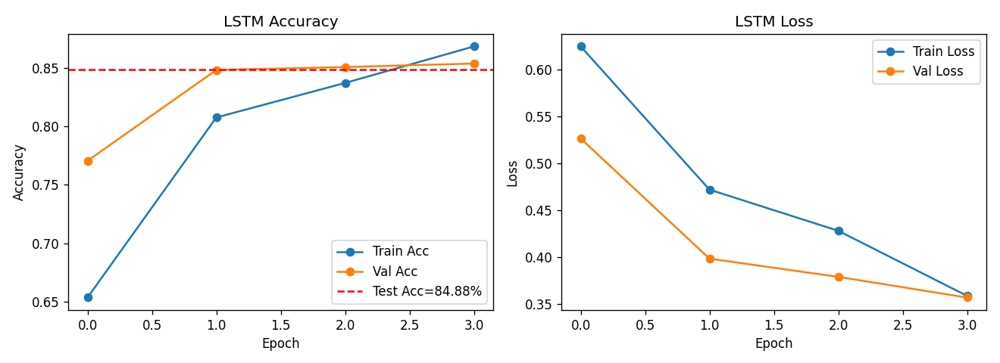

# IMDb Sentiment Analysis with LSTM

Binary sentiment classification of movie reviews using TensorFlow/Keras. The model learns to classify reviews as positive or negative using tokenized text and an LSTM network.

## Reported results

These are supplied historical results, not a new training run.

| Metric | Value |
|---|---:|
| Test accuracy | 84.88% |
| Test binary cross-entropy loss | 0.3683 |
| Macro F1 | 0.8486 |
| Test reviews | 10,000 |

| Class | Precision | Recall | F1 | Support |
|---|---:|---:|---:|---:|
| Negative | 0.8757 | 0.8130 | 0.8432 | 5,000 |
| Positive | 0.8255 | 0.8846 | 0.8540 | 5,000 |



## Pipeline

1. Lowercase text, remove HTML tags and non-alphabetic characters, and normalize whitespace.
2. Re-split the combined 50,000 reviews into a stratified 40,000-review development set and 10,000-review test set using random seed 42.
3. Fit a tokenizer on the development reviews using a 10,000-word vocabulary and an out-of-vocabulary token.
4. Pad or truncate each sequence to 120 tokens.
5. Train an embedding and LSTM classifier for four epochs with batch size 256.
6. Evaluate on test reviews and save training curves and a classification report.

Keras holds out 10% of the 40,000 development examples for validation, so 36,000 examples are used for gradient updates and 4,000 for validation. This custom split does not use the original IMDb benchmark split.

## Architecture

Embedding (64 dimensions), LSTM (32 units, dropout and recurrent dropout 0.2), Dense (16 units, ReLU), Dropout (0.3), Dense (1 unit, sigmoid). Training uses Adam and binary cross-entropy. The classification threshold is 0.5.

## Run locally

Use a Python environment compatible with TensorFlow, such as Python 3.11. Supply a CSV containing exactly 50,000 rows with columns `Reviews` (text) and `Sentiment` (labels `pos` or `neg`). Dataset files are excluded from the repository.

```bash
python -m venv .venv
```

Activate on Windows PowerShell:

```powershell
.venv\Scripts\Activate.ps1
```

On macOS/Linux:

```bash
source .venv/bin/activate
```

Install and train:

```bash
python -m pip install -r requirements.txt
python sentiment_lstm_fast.py --data data/imdb_full.csv --output-dir outputs
```

Generated outputs are `outputs/lstm_training_curves.png` and `outputs/sentiment_results_summary.txt`. CPU training time depends on the machine.

## Scope and reproducibility

- This repository contains training and evaluation code, supplied result summaries, and a chart. It does not include trained weights, a saved tokenizer, or an interactive prediction interface.
- The supplied results support 84.88% test accuracy. They do not support an 88.30% claim for this run.
- The tokenizer is fitted before the internal validation split, so validation vocabulary influences preprocessing. For stricter validation, split first and fit the tokenizer on training reviews only.
- NumPy and the dataset split use seed 42, but the original code does not seed TensorFlow. Dependencies were not versioned in the supplied environment. Exact repeatability is therefore not guaranteed.
- Syntax was checked while packaging. Training was not rerun because the dataset was not supplied.

## Files

- `sentiment_lstm_fast.py`: training and evaluation script with configurable paths and input checks.
- `requirements.txt`: Python dependencies.
- `results/`: supplied historical results and chart.
- `.gitignore`: excludes environments, datasets, local outputs and model artifacts.
